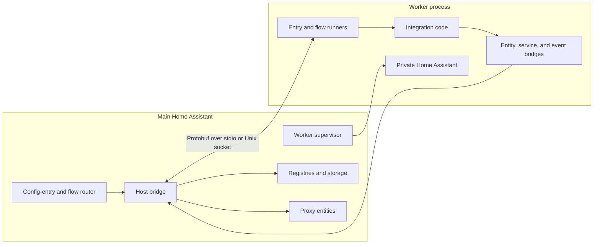

# Home Assistant Sandbox

Sandbox runs selected config-entry integrations in worker processes. The main Home Assistant instance owns configuration, persistence, registries, and proxy entities. Each worker runs a private Home Assistant instance and the integration code.

This is an experimental execution model for trusted code. **It does not provide a security boundary.** The host and worker must use the same Core revision. This package requires the Core changes on the `sandbox` branch.

## Architecture



The default placement uses one group for built-in integrations and one for custom integrations. A group shares one process and one private Home Assistant instance. It is not one process per config entry.

1. Bootstrap installs the router before integration setup. The router sends selected domains to a worker. Other domains use normal local setup.
2. The supervisor starts the worker with `python -m homeassistant_sandbox`. The worker loads its registries, connects the channel, installs handlers, and loads restore state. It calls `hass.async_start()` before sending `Ready`.
3. The host sends a config-entry snapshot. The worker sets it up after startup. Entry and subentry IDs are preserved. Supported configuration changes flow in both directions. Conflicting edits require a reload.
4. The worker sends entity descriptions and state updates. The host registers typed proxy entities. Entity actions become service calls or entity queries to the worker. The host retains canonical entity and device identities.
5. Worker `Store` operations use a context variable to route persistence through the host. Storage is namespaced by group. An acknowledged configuration update means the host accepted it and scheduled a save; it does not guarantee a disk flush.

On a worker crash, its proxies become unavailable. The supervisor has a bounded restart policy. Recovery removes the old platforms before reloading entries. Graceful shutdown unloads entries, flushes stores, and returns restore-state data. The host can terminate a worker that does not stop.

## Code map

Paths below are relative to this package.

| Area | Start here |
| --- | --- |
| Host routing and process supervision | [router.py](../../homeassistant/components/sandbox/router.py), [manager.py](../../homeassistant/components/sandbox/manager.py) |
| Host ownership checks and entity registration | [bridge.py](../../homeassistant/components/sandbox/bridge.py) |
| Typed entity proxies | [entity/](../../homeassistant/components/sandbox/entity/) |
| Worker startup and shutdown | [runtime.py](homeassistant_sandbox/runtime.py) |
| Integration and flow execution | [entry_runner.py](homeassistant_sandbox/entry_runner.py), [flow_runner.py](homeassistant_sandbox/flow_runner.py) |
| Entity export and configuration writeback | [entity_bridge.py](homeassistant_sandbox/entity_bridge.py), [entry_sync.py](homeassistant_sandbox/entry_sync.py) |
| Wire contract | [sandbox.proto](proto/sandbox.proto), [channel.py](homeassistant_sandbox/channel.py) |
| Host and real-worker tests | [tests/components/sandbox/](../../tests/components/sandbox/) |
| Worker tests and compatibility adapters | [tests/](tests/), [testing/](homeassistant_sandbox/testing/) |

Core hooks live in `config_entries.py`, `bootstrap.py`, and `setup.py` for routing; `helpers/entity_component.py` for proxy platforms; `helpers/storage.py` and `helpers/sandbox_context.py` for persistence; and `loader.py` and `helpers/translation.py` for remote metadata and strings. These paths are under `homeassistant/` at the repository root.

## Run locally

Use a separate development configuration. Moving existing entities back to local execution is not implemented.

From the Core repository root:

```sh
uv venv .venv
. .venv/bin/activate
script/setup
uv pip install --no-deps -e packages/home-assistant-sandbox
deactivate
```

`script/setup` installs integration requirements for Core development. The host starts workers with its own Python interpreter. The worker disables automatic requirement installation, so that environment must contain the selected integration's dependencies.

Add explicit domains to the development configuration:

```yaml
sandbox:
  integrations:
    - example_domain
```

Replace `example_domain` with the domain of a config-entry integration under test. Start the host from the repository root:

```sh
uv run --no-sync hass -c config
```

Create or load its config entry through Home Assistant. The host launches the worker when needed. Running the worker module alone does not connect it to a host.

Selection is not a compatibility allowlist. A missing or empty list leaves routing inactive. For selected domains, the host skips both `async_setup` and synchronous `setup`, even when YAML is present. Only config entries run in the worker. YAML-created instances are outside scope. Startup or setup failure leaves the entry in error, without local fallback.

Built-in code comes from the matching checkout. Custom code requires a registered source resolver with a repository URL, commit ref, and integration path. The worker fetches the source before setup. Marketplace installation metadata is not yet connected to this resolver.

## Tests and protocol changes

Run host tests from the repository root:

```sh
uv run --no-sync pytest tests/components/sandbox
```

Run worker tests in their own environment:

```sh
cd packages/home-assistant-sandbox
uv sync
uv run --no-sync pytest
```

The host suite includes actual subprocess tests. In-process adapters alone do not verify the process boundary. For Core hook changes, also run the affected config-entry, setup, bootstrap, loader, or helper tests.

The protocol is symmetric: either side can send requests, responses, and pushes. Stream frames contain length-prefixed Protobuf messages. Handlers can call back through the channel. Keep the reader free to dispatch replies.

`channel.py`, `codec_protobuf.py`, `messages.py`, `entry_sync.py`, and the generated bindings are mirrored between the host and worker. Change both copies together. After protocol changes, run these commands from the repository root:

```sh
bash packages/home-assistant-sandbox/proto/generate.sh
bash packages/home-assistant-sandbox/proto/check_mirror_drift.sh
bash packages/home-assistant-sandbox/proto/check_drift.sh
uv run --no-sync prek run --files <changed-files>
```

The generator uses a temporary environment with pinned compiler dependencies. Do not edit generated bindings by hand. Add coverage for both ends of a new message, including failure and cleanup behavior.

## Current limits

- Shared Python managers are outside v1. Integrations that need live MQTT, Bluetooth, mesh, or other manager objects from the host need further work. An integration's own client library or coordinator can run in its worker.
- State or registry access across groups is incomplete. Integrations that depend on other integrations need individual verification.
- Streaming, voice, camera, and subscription APIs need additional protocol support. A typed proxy does not establish full platform compatibility.
- General options flows, worker-initiated reauth, progress/external flow steps, and registry rename/disable parity remain incomplete. Initial entry setup failures require manual reload.
- Stdio and Unix sockets are implemented. Remote WebSocket transport and importing entities from an independent Home Assistant are proposals, not implemented features.
- The Dockerfile packages matching host libraries and worker code. The Compose example depends on host listener options that are not implemented. It is not a complete deployment recipe.

## Work together

Use merges to bring `dev` into the shared `sandbox` branch. Do not rebase or force-push the shared branch. Build focused changes on top of it so other contributors can follow the history.

Keep changes within one area where possible: host routing, worker lifecycle, entity proxies, protocol, or tests. For changes across areas, include both sides in the same commit. Preserve ownership checks, entry/subentry IDs, and cleanup on unload or disconnect.

Keep this README aligned with the implementation. Document limitations when adding partial support. Detailed contributor guides can move to [Home Assistant Contributors](https://contributors.home-assistant.io/) when the interfaces are ready.
